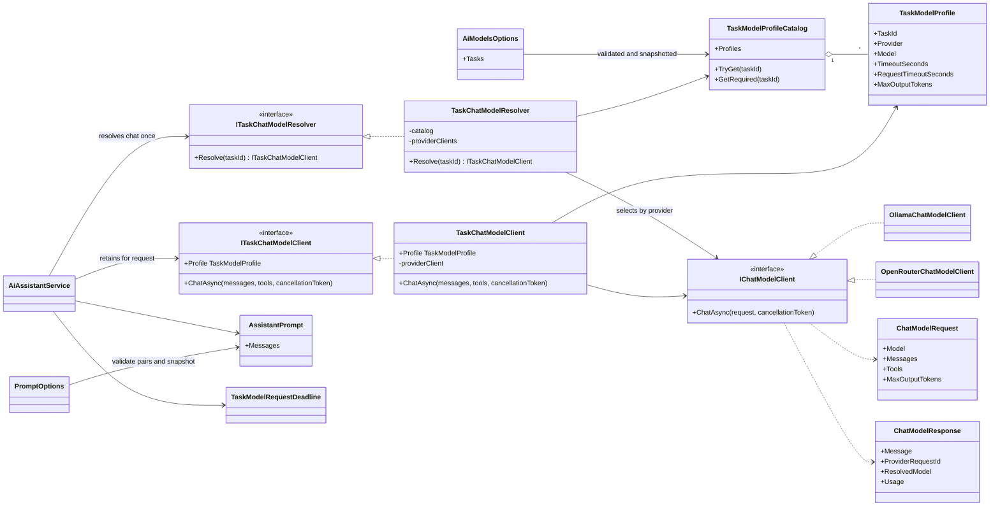
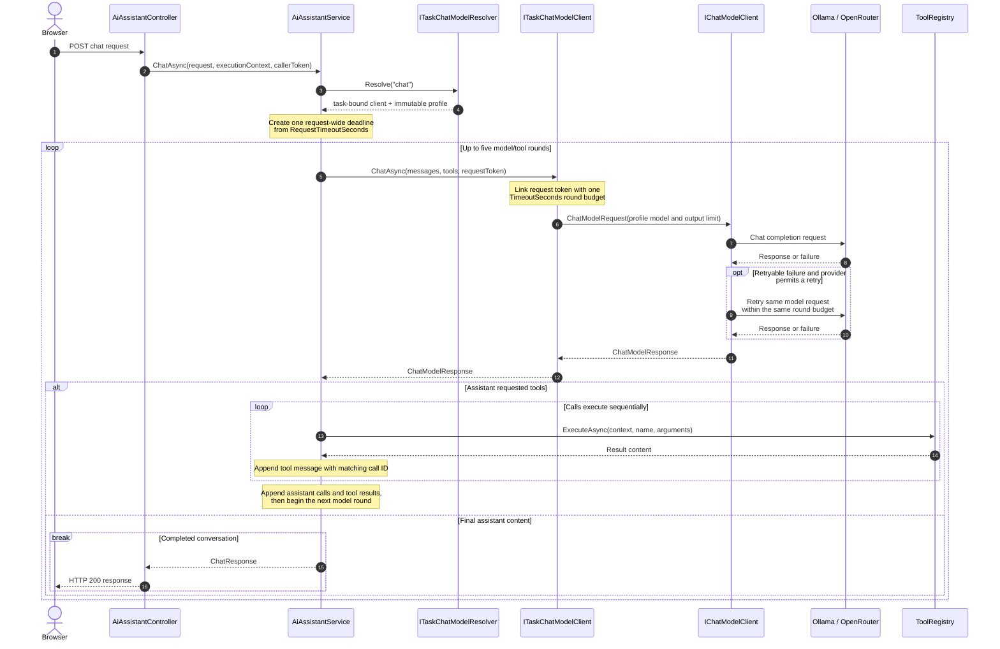

# OpenRouter Integration and Task-Specific Model Specification

> Status: **In progress: tasks 1-7 implemented; OpenRouter errors, retries, telemetry, and deployment pending**
>
> Scope: `ai-assistant-service`, its tests, Docker Compose configuration, and
> environment documentation.
>
> Last reviewed against OpenRouter documentation: **September 27, 2026**

## 1. Problem and decision

Before this migration, the AI assistant depended directly on Ollama request/response types,
configuration, endpoint paths, and failure messages. This prevented selecting a
hosted model through OpenRouter without changing the assistant's orchestration
logic.

Introduce a provider-neutral chat model boundary and add OpenRouter as a
supported provider. Keep Ollama available for local development and
offline/self-hosted deployments. Configure a provider/model pair for each
application task and allow Ollama and OpenRouter to coexist in the same process.
Backend code selects an explicit task identifier; a deterministic resolver uses
that task's validated configuration. No AI chooses the provider or model.

OpenRouter will use its OpenAI-compatible, non-streaming Chat Completions API:

```text
POST https://openrouter.ai/api/v1/chat/completions
```

The OpenRouter model assigned to the existing `chat` task must support client
tool/function calling. Model slugs remain configuration, not application code.
This phase implements the routing foundation and migrates existing chat only.
Category resolution and hiring are separate features, not new workflows here.

### Goals

- Allow `ai-assistant-service` to use an OpenRouter-hosted conversational model.
- Preserve the existing MCP discovery, tool execution, grounding, mentions,
  sources, few-shot examples, and maximum tool-round behavior.
- Preserve Ollama as a selectable provider.
- Keep provider-specific wire formats outside `AiAssistantService`.
- Protect the OpenRouter API key and place an explicit spending limit on it.
- Return safe, actionable user messages while retaining useful structured
  diagnostics in server logs and traces.
- Make switching models or providers a configuration-only deployment change.
- Support independent task mappings, including multiple models on one provider
  and mixed Ollama/OpenRouter mappings, without duplicating provider adapters.

### Non-goals

- Removing Ollama or the Ollama Docker services in the initial rollout.
- Changing product, booking, payment, notification, or MCP contracts.
- Moving tool execution from TaskMaster services to OpenRouter.
- Allowing the browser or frontend BFF to call OpenRouter directly.
- Streaming responses to the browser.
- AI-driven routing, browser-selected task/model/provider names, automatic
  cross-model/provider failover, or hot-reloading mappings during a request.
- Implementing category-resolution or hiring workflows, their prompts, output
  schemas, endpoints, or tool permissions. A mapping alone creates no feature.
- Committing to Jev, Gemma, or other unverified model slugs/capabilities.
- Adding OpenRouter server tools, web search, plugins, or hosted MCP.
- Changing the public `ChatRequest` or `ChatResponse` schema, except that
  `ChatResponse.Model` will contain the model configured for `chat`, including
  an OpenRouter slug when that task uses OpenRouter.

## 2. Current implementation and preserved behavior

`AiAssistantService` currently:

1. Loads the system prompt and static few-shot examples.
2. Includes at most the last two eligible history messages.
3. Sends all registered local and MCP tool definitions to the model.
4. Executes requested tools with an immutable `ToolExecutionContext`.
5. Removes ungrounded search filters before tool execution.
6. Repeats the model/tool loop for at most five rounds.
7. Derives `sources` and TaskMaster `mentions` only from tools executed for the
   current request.

These behaviors remain provider-independent and must not regress.

Failure handling and cancellation are intentional exceptions: adapters will
stop fabricating assistant messages on failure. Section 7 defines the replacement
behavior, including the Ollama messages that remain unchanged.

The former `IOllamaClient`, `OllamaChatMessage`, and `OllamaToolCall` types leaked
Ollama naming into orchestration; task 5 removed them. Ollama tool-call arguments deserialize as a
JSON object, while OpenRouter returns `function.arguments` as a JSON-encoded
string. OpenRouter also requires each tool result to reference the originating
call through `tool_call_id`.

Pointing the existing `OllamaClient` at OpenRouter is therefore not sufficient.

## 3. Architecture

### Provider-neutral contract

Replace the orchestration dependency on `IOllamaClient` with a task resolver and
task-bound client. Keep this lower-level interface for provider adapters:

```csharp
public interface IChatModelClient
{
    Task<ChatModelResponse> ChatAsync(
        ChatModelRequest request,
        CancellationToken cancellationToken);
}
```

The domain model must represent:

- Model identifier.
- Ordered messages.
- Optional function tool definitions.
- Assistant content.
- Zero or more tool calls.
- Stable tool-call ID.
- Tool name.
- Parsed JSON-object arguments.
- Tool result message with its matching tool-call ID.
- Optional provider metadata needed for diagnostics, without exposing it in the
  browser response.

Recommended internal shapes:

```csharp
public sealed record ChatModelRequest(
    string Model,
    IReadOnlyList<ChatModelMessage> Messages,
    IReadOnlyList<ChatModelTool>? Tools,
    int MaxOutputTokens);

public sealed record ChatModelTool(
    string Name,
    string Description,
    JsonElement Parameters);

public sealed record ChatModelMessage(
    string Role,
    string? Content,
    IReadOnlyList<ChatModelToolCall>? ToolCalls = null,
    string? ToolCallId = null);

public sealed record ChatModelToolCall(
    string Id,
    string Name,
    IReadOnlyDictionary<string, JsonElement> Arguments);

public sealed record ChatModelResponse(
    ChatModelMessage Message,
    string? ProviderRequestId = null,
    string? ResolvedModel = null,
    ChatModelUsage? Usage = null);

public sealed record ChatModelUsage(
    long? InputTokens,
    long? OutputTokens,
    long? TotalTokens);
```

Exact type names may follow repository conventions, but provider names must not
appear in the shared contract.

`ChatModelTool.Parameters` contains the existing JSON Schema object, not an
anonymous wire DTO. Adapters serialize provider-specific wrappers. Retained
`JsonElement` values must remain valid after their source document is disposed.

`ChatResponse.Model` always reports the configured/requested identifier, including
on safe failure responses, from the bound `chat` profile. The provider-reported
resolved model is diagnostic metadata only.

### Task selection and isolation

Use a small deterministic resolver, not a model-driven router:

```csharp
public interface ITaskChatModelResolver
{
    ITaskChatModelClient Resolve(string taskId);
}

public interface ITaskChatModelClient
{
    TaskModelProfile Profile { get; }

    Task<ChatModelResponse> ChatAsync(
        IReadOnlyList<ChatModelMessage> messages,
        IReadOnlyList<ChatModelTool>? tools,
        CancellationToken cancellationToken);
}

public sealed record TaskModelProfile(
    string TaskId,
    string Provider,
    string Model,
    int TimeoutSeconds,
    int RequestTimeoutSeconds,
    int MaxOutputTokens);
```

The task-bound client holds an immutable validated profile and the selected
provider adapter. It builds `ChatModelRequest` with that profile's model/output
limit and enforces the per-round budget. Callers cannot override those settings
through model arguments. Provider names in configuration/profile metadata are
selection identifiers, not provider-specific message types or wire contracts.

`AiAssistantService` resolves the server-owned constant `chat` once at the start
of a request, creates its end-to-end deadline from that profile, and uses the
same bound client for all rounds/retries. It does not derive the task from user
text, history, tool arguments, or public request fields. The resolver does not
create/reset the end-to-end deadline on each round.

Only `chat` is a production caller in this phase. Additional configured task IDs
can be resolved by future backend callers using these same adapters; prove this
with synthetic internal tasks in tests, not new category/hiring endpoints.
Unknown IDs fail explicitly before any provider call, with a structured
configuration-error diagnostic and no fallback to `chat`. Do not log arbitrary
unrecognized input as a metric label.

All configured profiles are validated and snapshotted at startup. Changes take
effect after restart/redeployment, not in the middle of an in-flight request.
Keep transcript, tool definitions, IDs, deadlines, and execution context local to
each invocation. Never mutate shared HttpClient defaults or a shared "current
model" when selecting a task. Resolving one task must not affect another.

Adding a profile does not grant tool access or guarantee output capabilities.
The owning workflow supplies its authorized tools and validates its outputs.
The current chat task retains the existing tool set and authorization. Future
structured category decisions or hiring actions require their own contracts
and capability validation; they are not implemented by this foundation.

### Architecture diagrams

The following class diagram shows the provider-neutral boundary. Configuration
is validated and snapshotted once, the resolver binds a task profile to an
independently registered provider adapter, and orchestration uses only the
task-bound interface.



The request flow uses one task selection and one end-to-end deadline. Each model
round receives a smaller linked deadline; retries remain inside that same round
budget. Tool execution returns to orchestration and is never restarted by an
adapter retry.



### Implementations

Implement:

- `OllamaChatModelClient`
- `OpenRouterChatModelClient`

Register provider adapters independently (for example using .NET 8 keyed DI),
with separate HttpClient configuration. Register one task resolver over the
validated profile map. Both adapters may be used in one process; do not register
one global `IChatModelClient` chosen by a single provider setting.
`AiAssistantService` depends on `ITaskChatModelResolver`, not concrete adapters.
Do not branch on provider or task inside the tool loop. Credentials/base URLs
belong to provider configuration and never to a browser-facing task profile.

The unused legacy `GenerateAsync` method was removed in task 4 after inventorying
its callers and preserving model-not-found coverage. Task 5 removed the remaining
legacy chat client and contracts after migrating orchestration and its tests.

**Tasks 4-5 implementation:** `OllamaChatModelClient` is registered with the task
resolver, and `AiAssistantService` now uses the task-bound client for every round.
The adapter uses the native `/api/chat` endpoint, `stream: false`, `think: false`,
and `options.num_predict` for `ChatModelRequest.MaxOutputTokens`. Its dedicated
HTTP client has an infinite timeout so the task-bound cancellation budget is
authoritative. It never retries or fabricates assistant messages on failure.

Ollama wire messages do not require OpenRouter's `tool_call_id`. The adapter
retains stable IDs internally and resolves each result's ID to the originating
call's name when writing Ollama's `tool_name`. It rejects an unresolvable result
before HTTP rather than guessing the association. See the native
[chat API](https://docs.ollama.com/api/chat) and
[tool-calling examples](https://docs.ollama.com/capabilities/tool-calling).

**Task 7 implementation:** `OpenRouterChatModelClient` is independently
registered with an infinite `HttpClient` timeout and uses the same task-bound
budgets as Ollama. It sends the full `/api/v1/chat/completions` endpoint,
server-side bearer authentication, optional attribution/hidden visibility,
privacy-preserving provider routing, `stream: false`, and each profile's model
and output limit. It preserves native tool-call IDs, serializes arguments as the
required JSON string, emits matching `tool_call_id` values for results, and maps
resolved-model/request/usage fields only into diagnostic response metadata.
Full status/envelope classification and bounded retries remain Task 8.

### Tool-call identity

Every internal tool call must have a non-empty ID.

- OpenRouter IDs are preserved exactly.
- If Ollama omits an ID, the Ollama adapter generates a request-local ID.
- `AiAssistantService` copies the ID to the corresponding tool result message.
- Multiple tool calls in one assistant response are executed and returned with
  their own matching IDs.

Tool results must retain the existing execution order. Parallel tool execution
is outside this scope because tools may have domain side effects or ordering
dependencies.

These identity rules also apply to seeded examples. Extend `FewShotToolCall`
with an ID and `FewShotTurn` with a tool-result call ID, and migrate
`PromptOptions:FewShotExamples` in the same change. Use explicit, stable IDs such
as `seed_example_0_call_0`. Validate examples before serving requests: each result
must reference exactly one preceding, unresolved call, and all calls must receive
results before the next conversational turn. Missing, duplicate, or dangling IDs
are configuration errors. Keep IDs unique across the assembled conversation;
generated Ollama IDs must not collide with seed IDs. Never guess pairings for
multiple calls.

### Argument normalization

The OpenRouter adapter must:

1. Inspect the response for an error envelope, even on HTTP 200, before reading
   `choices[0].message` (see Section 7).
2. Treat a missing first choice or missing message as a provider protocol error.
3. Parse each `function.arguments` JSON string.
4. Require the parsed root to be a JSON object.
5. Convert its properties to the internal argument dictionary.
6. Reject malformed JSON, arrays, scalars, missing names, or missing call IDs as
   provider protocol errors.

Do not silently replace malformed arguments with an empty object. Invalid model
output must not cause a tool to execute with altered semantics.

Move inline JSON tool-call recovery into the Ollama adapter. Validate recovered
names against `ChatModelRequest.Tools`, rather than injecting `ToolRegistry`.
Preserve the compatibility behavior and generate IDs for recovered calls.
OpenRouter must use native calls; shared orchestration must not run this parser.

## 4. OpenRouter wire contract

### Request

Send:

```json
{
  "model": "configured/model-slug",
  "messages": [],
  "tools": [],
  "stream": false,
  "max_tokens": 1024,
  "provider": {
    "allow_fallbacks": true,
    "require_parameters": true,
    "data_collection": "deny"
  }
}
```

Requirements:

- Send `Authorization: Bearer <api-key>`.
- Send `Content-Type: application/json`.
- Attribution is opt-in through a configured `HTTP-Referer`. When enabled, send
  it with `X-OpenRouter-Title` and `X-OpenRouter-App-Visibility: hidden`.
  A title alone does not create attribution. The visibility header only hides
  a newly created app; an existing app needs a visibility review and potentially
  OpenRouter support. It does not retroactively hide an existing public app.
- Never send Ollama's `think` property to OpenRouter.
- Include `tools` on every round in a tool-calling conversation.
- Set `provider.require_parameters` to `true` so routing only selects endpoints
  that support the requested parameters, including tools.
- Default `provider.data_collection` to `deny`.
- Keep provider fallbacks enabled by default for availability, but make the
  setting configurable.
- Do not include unsupported or speculative request fields.

Send the selected profile's positive `MaxOutputTokens` as `max_tokens` every round,
initially 1024 for `chat`. This bounds output per attempt, not total chat cost:
input tokens,
reasoning behavior, retries, and additional rounds still matter. Keep the separate
key credit limit. `MaxOutputTokens` is enforced by OpenRouter in this phase;
Ollama accepts the profile field but retains its existing generation settings.
Do not claim the field caps Ollama output.

The `chat` model must be chosen from OpenRouter models supporting the
`tools` and `max_tokens` parameters. Verify both through OpenRouter's model
catalog before changing the configured slug.

### Response

After checking for errors, map the first choice's message into the internal
contract. Preserve:

- `role`
- `content`
- `tool_calls[].id`
- `tool_calls[].function.name`
- `tool_calls[].function.arguments`

An assistant tool-call message sent in a later round must contain the original
ID and arguments. Its matching tool result must use:

```json
{
  "role": "tool",
  "tool_call_id": "call_abc123",
  "content": "serialized tool result"
}
```

The implementation remains non-streaming in this phase.

Inspect `finish_reason`: a length-limited completion must not be presented as a
complete answer or have its tool calls executed. Map it to invalid output without
automatic retry. Map a content-filter finish reason to policy rejection. A
response with neither tool calls nor nonblank assistant content is invalid output,
not a successful empty answer.

## 5. Configuration

Use a provider-neutral task map for model selection and execution budgets, plus
shared provider-specific connection settings. Ship only the implemented `chat`
mapping by default:

```json
{
  "AiModels": {
    "Tasks": {
      "chat": {
        "Provider": "Ollama",
        "Model": "qwen3:8b",
        "TimeoutSeconds": 60,
        "RequestTimeoutSeconds": 300,
        "MaxOutputTokens": 1024
      }
    }
  },
  "Ollama": {
    "BaseUrl": "http://host.docker.internal:11434"
  },
  "OpenRouter": {
    "BaseUrl": "https://openrouter.ai/api/v1",
    "ApiKey": "",
    "HttpReferer": "",
    "AppTitle": "TaskMaster Hub",
    "AllowFallbacks": true,
    "RequireParameters": true,
    "DataCollection": "deny",
    "MaxRetries": 1
  }
}
```

Production-style environment variables (the secret interpolation below is for
deployment tooling, not a literal value to put in a Windows environment variable):

```text
AiModels__Tasks__chat__Provider=OpenRouter
AiModels__Tasks__chat__Model=<tool-capable-openrouter-model-slug>
AiModels__Tasks__chat__TimeoutSeconds=60
AiModels__Tasks__chat__RequestTimeoutSeconds=300
AiModels__Tasks__chat__MaxOutputTokens=1024
OpenRouter__ApiKey=${OPENROUTER_API_KEY}
OpenRouter__BaseUrl=https://openrouter.ai/api/v1
OpenRouter__AppTitle=TaskMaster Hub
OpenRouter__AllowFallbacks=true
OpenRouter__RequireParameters=true
OpenRouter__DataCollection=deny
OpenRouter__MaxRetries=1
```

Rules:

- `AiModels:Tasks` requires `chat`; each entry is a complete task profile, with
  no silent fallback/inheritance from another task or a global model.
  Task identifiers use canonical lowercase letters, digits, and underscores,
  starting with a letter (for example `chat`). Backend callers use exact IDs.
- Each profile's `Provider` accepts only `Ollama` or `OpenRouter`,
  case-insensitively. Unknown providers, empty models, missing fields, and
  invalid budgets fail startup with the affected task identified safely.
- Validate every configured profile, even if no caller uses it yet. Additional
  valid task IDs are allowed, but do not activate a workflow by themselves.
- Require the shared OpenRouter API key and valid base URL if any profile uses
  OpenRouter. Require Ollama's valid base URL if any profile uses Ollama.
  Unused providers need no credentials or reachable infrastructure; an
  all-Ollama task map must start without an OpenRouter key.
- `OpenRouter:ApiKey` is supplied only through environment/deployment secrets.
- No real key is written to `.env.example`, `appsettings*.json`, tests, logs,
  container images, or Git history.
- `.env.example` documents a placeholder and recommends a per-key OpenRouter
  credit limit.
- Existing `Ollama__Model` and `Ollama__TimeoutSeconds` configuration is migrated
  to `AiModels__Tasks__chat__Model` and `AiModels__Tasks__chat__TimeoutSeconds`.
  The earlier proposed global `AiModel` section is superseded; do not introduce
  a second configuration path or silently honor obsolete global settings.
- `TimeoutSeconds` is the budget for one model round, including all HTTP
  attempts, response parsing, retry delays, and provider fallback latency.
  Never reset it per retry. Preserve 60 seconds in appsettings and 600 seconds
  in local Ollama Compose when migrating the current settings.
- `RequestTimeoutSeconds` is a separate end-to-end budget covering prompt
  preparation, all rounds, and tool execution. Default to 300 seconds; local
  Ollama Compose uses 3000 seconds to retain the existing five-round inference
  allowance. OpenRouter Compose uses 60 seconds per round and 300 end-to-end.
- Validate both timeouts and `MaxOutputTokens` in each profile as positive; its
  request budget must be at least the round budget. Constrain `MaxRetries` to 0 or 1 and require
  `RequireParameters=true` in this phase.
- Missing keys fail startup; nonempty invalid/revoked keys are detected on the
  first real request, not through paid inference at startup.

Use strongly typed options with startup validation rather than repeated string
lookups inside request handling.

All OpenRouter tasks share `OpenRouter:ApiKey`, base URL, attribution, routing
policy, and retry limit; Ollama tasks share its base URL. Per-task credentials,
multiple accounts/endpoints for the same provider, and per-task routing policy
overrides are outside this phase. The shared key's credit limit covers aggregate
usage, not an independent allowance for every task.

For illustration, future code could resolve `category_resolution` and `hiring`,
each with its own complete profile, while `chat` keeps its own pair. These names
are examples, not required/default profiles or implemented callers. Do not ship
placeholder model slugs for unimplemented features. Exact models and structured
output/tool-calling requirements must be decided in those feature specs.

## 6. Docker Compose behavior

The initial rollout keeps `ollama` and `ollama-init` so developers can select
the local provider.

For `ai-assistant-service`:

- Add the provider-neutral and OpenRouter environment mappings.
- Do not embed an API key in `docker-compose.yml`.
- Map `OpenRouter__ApiKey` using `${OPENROUTER_API_KEY:-}` so an all-Ollama map neither
  requires the key nor emits a missing-variable warning.
- In an OpenRouter-only deployment, do not depend on or start Ollama. Mixed
  deployments must retain Ollama infrastructure if any task uses local Ollama.

Keep the default `docker-compose.yml` on Ollama and add an explicit
`docker-compose.openrouter.yml` override. The override must:

- Select OpenRouter for `chat`, require `OPENROUTER_CHAT_MODEL` without an
  Ollama-model default, and apply the OpenRouter task budgets from Section 5.
- Remove only the inherited Ollama dependency with
  `depends_on: { ollama: !reset null }`, retaining other dependencies.
- Put both `ollama` and `ollama-init` behind the inactive `local-ollama` profile.
  Removing a dependency alone would still start otherwise unprofiled services.
  Profiles apply to services, not individual dependency edges.
- Require a Compose version supporting `!reset` and verify the merged service
  graph before deployment. Ordinary YAML merging does not remove dependencies.

Document these commands in the deployment README and `.env.example`:

```powershell
# Local Ollama (existing default)
docker compose up -d --build

# OpenRouter-only; supply OPENROUTER_CHAT_MODEL and OPENROUTER_API_KEY first
docker compose -f docker-compose.yml -f docker-compose.openrouter.yml up -d --build
```

Do not enable `local-ollama` or explicitly target its services in OpenRouter-only mode.
A fresh OpenRouter-only deployment must neither start Ollama nor download its model.
When switching an existing stack to OpenRouter-only, explicitly stop `ollama-init` and `ollama`
using the base file; applying an override does not stop running containers.
For the default chat-only deployment, rollback uses the base file again, restoring
the `chat` provider, model, URL, budgets, and services together, not merely its
provider name.

Document a third, mixed-provider deployment recipe using the base file (which
retains Ollama), plus explicit deployment environment mappings for every task.
Do not use the OpenRouter-only override for this recipe. Container environment
variables must be forwarded explicitly; setting an extra task variable in the
host shell alone does not automatically add it to the container.

Mixed deployments may have OpenRouter chat with another Ollama task, or Ollama
chat with another OpenRouter task. Check the entire profile map rather than
just `chat` when choosing topology and required secrets. Startup validation of
model settings does not prove a local Ollama process/model is available; the
runbook must provision every configured local model, not only `qwen3:8b`.
Use synthetic profiles for mixed-deployment validation in this phase; do not
add category-resolution/hiring features to demonstrate routing.

Rollback is per task: restore that profile's provider/model/budgets and the
required infrastructure, leaving other profiles unchanged. Do not stop Ollama
while another task still needs it, and do not remove the OpenRouter secret
while another profile still uses OpenRouter. Compose cannot infer service
dependencies from task-map environment variables; operators must select and
validate the matching deployment recipe.

## 7. Failure handling and retries

Provider failures must be represented by typed exceptions or results, not by
fabricating a successful assistant message.

Minimum categories:

| Category | Examples | Retry |
|---|---|---|
| Invalid configuration | Missing key, unknown provider | No; fail startup |
| Invalid request/model | HTTP 400, OpenRouter 404, unsupported parameters | No |
| Local model unavailable | Ollama HTTP 404, including a model not yet downloaded | No |
| Authentication | HTTP 401 | No |
| Credits exhausted | HTTP 402 not meeting both temporary-budget conditions below | No |
| Temporary in-flight budget | HTTP 402 with matching `limit_source` and valid `Retry-After` | Bounded retry |
| Policy/moderation | HTTP 403 | No |
| Timeout | exhausted client budget, HTTP 408/504 | Retry provider timeout only while budget remains |
| Rate limited | HTTP 429 | Honor `Retry-After`, bounded retry |
| Provider unavailable | HTTP 500/502/503, transport/connection failure | Honor `Retry-After`, bounded retry |
| Protocol error | Empty choices, malformed tool arguments | No |
| Caller cancellation | request cancellation token | No |

An HTTP 200 response containing `error` is a failure, never a successful
completion. Classify its numeric `error.code` with the same table and retain the
actual HTTP status separately. Inspect only allowlisted metadata such as
`limit_source`; do not log raw error messages or metadata. Unknown codes are
non-retryable provider failures; invalid error envelopes are protocol errors.
Neither may execute tools or fall through to successful message parsing.

Retry requirements:

- OpenRouter defaults to one retry per round, after its endpoint fallbacks are
  exhausted. Fallback tries another endpoint within one HTTP request; a client
  retry repeats that request after a surfaced transient failure. Keep Ollama at
  zero automatic retries to preserve existing request behavior.
- Honor valid `Retry-After` delta-seconds or HTTP-date values on retryable
  failures. If the delay exceeds the remaining budget, return the failure
  without retrying early.
- Use bounded exponential backoff with jitter when the header is absent or
  invalid, except for 402, which requires a valid header to be retryable.
- Never retry caller cancellation, authentication, ordinary insufficient
  credits, policy rejection, malformed requests, or malformed responses.
- A `402` is retryable only when
  `error.metadata.limit_source == "openrouter_in_flight_budget"` and a valid
  `Retry-After` is present. Either condition alone is insufficient.
- Use linked cancellation tokens for round and end-to-end budgets. An exhausted
  budget cannot be retried; provider 408/504 responses may be retried only while
  time remains. Avoid a separately resetting HttpClient timeout that obscures
  these budgets.
- Retry only the current model call with the same transcript. Never restart
  orchestration or re-execute completed tools. Timed-out inference may still
  incur charges; client retries do not guarantee billing idempotency.
- Keep the selected task/provider/model fixed for the whole invocation.
  Failures never switch to another task, model, or provider automatically.

`AiAssistantService` maps typed provider failures to a safe `ChatResponse`;
adapters never fabricate assistant messages. The controller retains HTTP 200 for
handled failures and its existing validation/authentication behavior. `Answer`
contains the safe message, `Model` the requested identifier, and `Sources` and
`Mentions` are empty, even if earlier rounds executed tools: a failure response
makes no data claims. Successful responses retain request-local metadata.
Never substitute a seeded or historical assistant answer for a failed request.

Caller cancellation propagates from both model and tool execution; do not swallow
it in the existing broad tool catch. An internally expired request budget maps to
timeout unless the caller also canceled, in which case caller cancellation wins.

Logs retain validated task ID, provider, model, status, retry count, and provider
request ID where available, but never API keys, authorization headers, complete
prompts, complete tool results, or raw response bodies containing user data.

OpenRouter user messages:

| Failure | User-facing behavior |
|---|---|
| Timeout/rate limit/transient outage | “The AI assistant is temporarily busy. Please try again shortly.” |
| Credits/auth/configuration | “The AI assistant is unavailable right now.” |
| Invalid request/model or unknown provider error | “The AI assistant is unavailable right now.” |
| Policy rejection | A neutral message that the request could not be processed |
| Invalid model output | “The AI assistant returned an invalid response. Please try again.” |

For Ollama, preserve the existing `ModelUnavailableMessage`, `TimeoutMessage`,
`UnreachableMessage`, and generic `ModelErrorMessage` text, selecting it at the
service boundary using typed failure categories. Keep this presentation mapping
outside the provider-neutral tool loop. Empty/malformed Ollama responses now
produce the invalid-response message rather than "No response from Ollama.";
caller cancellation now propagates. These intentional Phase 1 changes require
tests. Failures must be distinguishable in logs and metrics; a later public API
error-contract change requires a separate decision.

## 8. Security and privacy

- Create a dedicated OpenRouter key for TaskMaster Hub.
- Apply the smallest practical key credit limit and configure billing alerts.
- Rotate the key immediately if exposed.
- Keep the key server-side in `ai-assistant-service`.
- Do not expose a generic public route accepting task/provider/model selectors.
  A task mapping selects inference, not authorization; future workflows must
  still enforce their own tool permissions and required user confirmations.
- Redact authorization headers in HTTP telemetry and logs.
- Do not log full prompts, chat histories, tool arguments, tool results, or
  model completions at any level, including Debug and exception details.
- Retain only metadata needed for operations: model slug, provider, status,
  latency, retry count, token usage when returned, and request ID.
- Default OpenRouter routing to `data_collection: "deny"`.
- Review the selected upstream provider's retention and training policy before
  production use; OpenRouter routes to upstream providers with distinct terms.
- If stronger retention requirements apply, evaluate OpenRouter ZDR routing and
  provider restrictions before production rollout.
- Continue treating tool output as untrusted model context. The model must not
  gain direct network, database, payment, or shell access.
- Preserve existing authorization and `ToolExecutionContext` enforcement for
  every tool execution.

## 9. Observability

Required logging migration work in the existing implementation:

- Replace `AiAssistantService`'s Information-level argument dump with tool name
  and timing/outcome metadata.
- Remove payload-bearing tool-schema and `ExtractMentions` Debug logs.
- Remove raw response-body logging from `OllamaClient.EnsureSuccessAsync`.
- Remove the `AiAssistantService: Debug` override in `appsettings.json`; verify
  that enabling Debug still does not expose payloads.
- Audit exception logging in adapters and the tool-execution boundary because
  exception messages can contain user data.

HTTP instrumentation does not capture Authorization headers by default. Preserve
that behavior, redact the header in HttpClient logging configuration, and ensure
custom logging/enrichment never records it.

Use the existing server-side HTTP OpenTelemetry instrumentation. Do not add
browser tracing or a frontend OTLP proxy.

Add an `ActivitySource` and `Meter`, both named `TaskMaster.AiAssistant`, registered
through `AddSource` and `AddMeter`. Create chat and model-round activities;
instrument duration, failures, retry count, tool calls, and available token usage.
Keep request/generation IDs and round-specific details on traces/structured logs,
not metric dimensions.

Compose currently sets `OTEL_SDK_DISABLED=true`; retain this default and do not
claim telemetry is exported unless enabled with a reachable collector. Test
instrumentation using in-process `ActivityListener` and `MeterListener` instances,
independent of SDK/exporter availability. Explicitly enable the existing
server-side exporter for the telemetry smoke scenario.

Record:

- `ai.task` (validated, configured task ID only)
- `ai.model.provider`
- `ai.model.requested_model`
- `ai.model.resolved_model` when returned
- Request duration
- Tool-round number
- Tool-call count
- HTTP status/error category
- Retry count
- Input/output/total token usage when returned
- OpenRouter request/generation ID when available

Do not use model-generated text, prompts, user IDs, tool payloads, API keys, or
authorization headers as metric labels.

Health checks must not make paid inference calls. Startup/readiness validates
configuration only; actual provider availability is observed through normal
requests and telemetry.

## 10. Testing

### Provider-neutral orchestration tests

Update `AiAssistantServiceTests` to mock `ITaskChatModelResolver` and its returned
task-bound client, and verify:

- The server-owned `chat` ID is resolved once, and the same profile/client is
  used for every round. Public input cannot override it.
- The selected profile's model, output limit, and budgets are passed/enforced
  by the task-bound client, with no mutable global selection.
- System prompt, few-shot examples, history, and current user message retain
  their order.
- Seeded assistant/tool pairs have matching IDs on the first outgoing request,
  without live-ID collisions; malformed examples fail configuration validation.
- Tools are included on every model round.
- A returned tool call executes through `ToolRegistry`.
- The matching tool-call ID is included in the subsequent tool result.
- Multiple tool calls retain identity and order.
- The five-round guard remains effective.
- Tool failures remain safe and do not leak internal details.
- Sources and mentions still derive only from tools executed for this request.
- Caller cancellation is propagated.
- A provider failure after a successful tool round returns safe failure text,
  the requested model, and empty metadata, never a seeded/history answer.
- Tool cancellation escapes the broad exception handler; internal deadline
  expiry maps to timeout without starting further rounds or tools.

### OpenRouter client tests

Use a capturing `HttpMessageHandler`; do not call the real API in unit tests.
Verify:

- The resolved URI is `https://openrouter.ai/api/v1/chat/completions`; test base
  URLs with and without trailing slashes so resolution cannot drop `/api/v1`.
- Bearer authentication and configured attribution headers are present.
- The API key never appears in log output or exception messages.
- Attribution is omitted without a referer; enabled attribution sends the
  referer, title, and hidden-visibility headers together.
- Model, messages, tools, `stream: false`, and provider routing options serialize
  correctly.
- `think` is absent.
- `max_tokens` uses the configured positive limit on every round.
- OpenRouter stringified function arguments parse into typed internal arguments.
- Assistant tool-call IDs and tool-result `tool_call_id` values round-trip.
- Missing choices, missing messages, malformed arguments, and non-object
  arguments fail explicitly.
- HTTP 400, 401, 402, 403, 404, 408, 429, 500, 502, 503, and 504 map to the intended
  failure categories.
- HTTP 200 error envelopes are classified before choices and never execute tools;
  unknown codes and malformed envelopes fail explicitly.
- 402 retries require both matching budget metadata and valid `Retry-After`;
  test either missing, unrelated metadata, and malformed headers.
- `Retry-After` formats, retry limits, and shared timeout budgets are honored;
  an over-budget delay does not trigger an early retry.
- Length-limited, content-filtered, and empty completions fail safely.
- Caller cancellation is not converted into a timeout or retried.

### Ollama regression tests

Retain coverage for:

- `/api/chat` request shape.
- `think: false`.
- Optional tools.
- Model-not-found behavior.
- Timeout and connection failures.
- Native and inline compatibility tool calls.
- Generated internal tool-call IDs when Ollama omits them.
- Inline recovery validates names against request tools without `ToolRegistry`.
- Ollama failure text survives the typed-failure migration except for the
  explicit invalid-output and cancellation changes in Section 7.
- Remove obsolete `GenerateAsync` tests from `OllamaClientTests` only after
  confirming removal is safe; move relevant failure cases to chat tests.

### Configuration and integration tests

Verify:

- Missing `chat`, invalid task identifiers, incomplete profiles, and unknown
  providers fail startup, including invalid additional profiles without callers.
- Any OpenRouter profile requires its shared key/base URL and its own model.
  An all-Ollama map does not require the OpenRouter key.
- Multiple tasks can resolve different models on the same adapter.
- Mixed task profiles resolve the correct independent adapters in one process.
- Concurrent synthetic tasks retain separate models, limits, deadlines,
  transcripts, tool definitions, and credentials, with no cross-task state leak.
- Unknown task resolution fails before HTTP and never defaults to `chat`.
- A model failure never triggers cross-task/model/provider fallback.
- Changing one profile and restarting changes only that task's selection.
  In-flight selections remain immutable; no live-reload behavior is promised.
- Authentication and existing controller behavior remain unchanged.
- Invalid timeouts, token limits, retry counts, and few-shot IDs fail validation.
- The public model stays requested/configured when the resolved model differs.
- Logs at Information and Debug exclude sentinel keys, prompts, arguments,
  results, completions, and sensitive exception/response text.
- Activity/Meter listeners observe metadata without an exporter or paid calls.
- All-Ollama, OpenRouter-only, and mixed deployment recipes render successfully
  with `docker compose config`. OpenRouter-only has no active Ollama dependency
  or services; mixed retains local Ollama where needed. Validate credentials
  against all profiles, not only the chat provider. Use fake secrets when
  inspecting rendered configuration.

A manual smoke test may use a low-cost, tool-capable OpenRouter model and a
restricted API key. It must cover:

1. A request requiring `search_task_masters`.
2. A request requiring the local booking tool.
3. A normal final answer after a tool result.
4. A follow-up using recent conversation history.
5. A temporary invalid key to confirm safe failure behavior.

Do not add a live, paid OpenRouter call to the default CI suite.

## 11. Rollout

### Phase 1: Provider-neutral refactor

- Introduce internal chat model contracts.
- Add the task map, immutable bound clients, and explicit task resolver; migrate
  existing chat to the `chat` profile without introducing other workflows.
- Adapt Ollama to the new contract.
- Migrate seeded IDs and typed tool definitions.
- Introduce typed failures and service-boundary mapping; remove unsafe existing
  logs and preserve documented Ollama messages.
- Update orchestration/tests, including cancellation and invalid output. Confirm
  `GenerateAsync` callers before removal and migrate its tests.
- Keep the default `chat` profile on Ollama.
- Verify successful behavior remains unchanged and the intentional failure
  changes in Section 7 behave as specified.

### Phase 2: OpenRouter implementation

- Add strongly typed OpenRouter options and validation.
- Register both provider adapters independently and cover same-provider
  multi-model and mixed-provider task selection with synthetic test callers.
- Implement request/response translation, tool-call identity, typed failures,
  retries, and safe logging.
- Add client and configuration tests.
- Update `.env.example`, deployment README, and all three deployment recipes, including
  version prerequisites, timeout migration, shutdown, and rollback commands.

### Phase 3: Non-production evaluation

- Create a dedicated credit-limited OpenRouter key.
- Select a model explicitly marked as supporting tools.
- Run the manual smoke scenarios.
- Compare tool-selection correctness, final-answer grounding, latency, and
  estimated cost against the current Ollama model.
- Test at least the representative category-resolution prompts already covered
  by assistant tests.

### Phase 4: Production opt-in

- Set `AiModels__Tasks__chat__Provider=OpenRouter` and its model/budgets only in
  the intended environment. Future callers opt in through their own profiles.
- Monitor failures, latency, tool rounds, token usage, and spend by task.
- Keep rollback configuration-only and task-specific, restoring the affected
  pair/budgets/infrastructure without changing other task mappings. Use the
  appropriate topology from Section 6; never retain an incompatible model slug.
- Do not remove Ollama until OpenRouter has met an agreed stability period and
  local/offline requirements have been reconsidered.

## 12. Acceptance criteria

The integration is complete when:

- `AiAssistantService` contains no dependency on Ollama-named interfaces or
  message types.
- Each task's provider/model is selectable through configuration and restart
  without recompilation; multiple profiles may coexist on either provider.
- Only `chat` is wired to a production workflow. Synthetic tests demonstrate
  additional task resolution without implementing category or hiring features.
- Unknown tasks and invalid profiles fail explicitly with no silent defaults.
- Parallel task calls and rollback of one task do not alter other selections.
- OpenRouter tool calls complete a multi-round request with correct call IDs.
- Seeded examples are valid on the first OpenRouter request.
- Malformed OpenRouter tool arguments never execute a tool.
- Existing grounding, authorization, sources, mentions, and loop limits pass
  their tests.
- Missing OpenRouter secrets fail startup when any profile uses it;
  invalid/revoked keys fail safely on requests. Neither appears in output.
- HTTP 200 errors, conditional 402 retries, per-round/end-to-end budgets, and
  output caps are handled and tested.
- Existing payload-bearing logs are removed; metadata is observable with
  in-process listeners and optionally enabled server telemetry.
- `.env.example` and Compose documentation explain all-Ollama, OpenRouter-only,
  and mixed task maps, including safe per-task rollback.
- The OpenRouter model selected for `chat` is documented as tool-capable.
- A smoke test demonstrates a grounded TaskMaster answer using an MCP tool.
- Switching back to Ollama requires only configuration and no code changes.
- Fresh OpenRouter-only deployment does not start or download Ollama.

## 13. Future considerations

These require separate decisions after the initial integration:

- Streaming responses.
- AI-driven request routing, automatic model/provider failover, or hot reload.
- Category-resolution and hiring workflows using separate task profiles,
  including their prompts, structured outputs, capability checks, and permissions.
- OpenRouter presets and workspace budgets.
- Strict ZDR or region-specific routing.
- Prompt caching.
- Provider cost/quality dashboards.

## 14. External references

- [OpenRouter quickstart](https://openrouter.ai/docs/quickstart)
- [OpenRouter authentication](https://openrouter.ai/docs/api_reference/authentication)
- [OpenRouter client tool calling](https://openrouter.ai/docs/guides/features/tool-calling)
- [OpenRouter provider routing](https://openrouter.ai/docs/guides/routing/provider-selection)
- [OpenRouter errors and debugging](https://openrouter.ai/docs/api_reference/errors-and-debugging)
- [OpenRouter limits](https://openrouter.ai/docs/api_reference/limits)
- [OpenRouter provider logging and retention](https://openrouter.ai/docs/guides/privacy/provider-logging)
- [OpenRouter app attribution](https://openrouter.ai/docs/app-attribution)
- [Docker Compose merge and reset rules](https://docs.docker.com/reference/compose-file/merge/)
